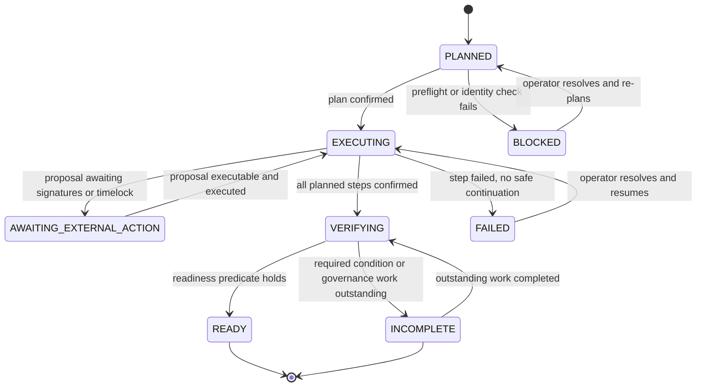

# UTEXO Smart Contract Deployment Library — Product Design

**Artifact type.** Product design. This document defines product behavior and product boundaries. It contains no implementation stories, execution slices, PR tasks, package layout, Go APIs, database schemas, or code-level architecture.

**Document location.** `docs/pdd/utexo-smart-contract-deployer.md` in the product repository. The product repository is a new, separate Go repository (decision). Its name is not yet given: `NEEDS_CONTEXT C1`.

**Document verification.** Review of this document is by other reviewers plus human plan approval. The product repository has no build or test gate, and none is assumed.

**Evidence basis.** Statements about the current contract implementation derive from the `source_context.md` snapshot of two repositories inspected on 2026-09-30 at branch `dev`: `UTEXO-Protocol/bridge-smart-contracts` at `dcb9d395c109d16d7afd2e5c96464f947d303953` and `UTEXO-Protocol/usdt0-smart-contracts` at `872548276f48cd8e71a8c1c626654a3691243aec`. No live repository inspection was performed for this document. `03_deployment_sequence_diagram.md` (developer-provided) is the authority for target deployment intent.

**Label vocabulary.** `MUST`, `MUST NOT`, `SHOULD`, and `MAY` mark normative requirements. `NEEDS_CONTEXT` marks a missing fact. `NEEDS_DECISION` marks an open product choice. Both are indexed in [Unresolved Product Decisions and Missing Context](#unresolved-product-decisions-and-missing-context).

## Operator Problem

Deploying the supported UTEXO contract suites today is a manual procedure over two contract repositories and two toolchains. An operator runs Foundry scripts in `bridge-smart-contracts` and `usdt0-smart-contracts`, and runs the TRON entrypoint deployment through TronBox, moving values by hand between steps.

The expensive part is not running a script; it is the state that lives between scripts. Deployment order, address dependencies between contracts, immutable versus mutable values, immediate versus timelocked actions, ownership handoff, and the post-deployment checklist are carried by operator memory, an environment file, and documentation.

A failure in the middle is the worst case. On-chain state already exists, no record states which step produced which address under which revision, and the operator reconstructs progress by reading the chain and re-reading the scripts.

The snapshot records the concrete consequences: predicted addresses depend on exact deployer nonce and deployment order; a partial deployment leaves expensive on-chain state; two-step ownership creates intermediate valid states; timelocked governance creates long-running deployment states; deployment spans multiple chains and two toolchains; explorer verification can fail independently of deployment; adapter trust configuration can only follow source entrypoint existence.

## Users

Primary user: a UTEXO deployment operator who holds deployer authority, runs the deployment, and is accountable for what lands on chain.

Secondary user: an engineer or reviewer who must determine, without secrets, what a given deployment did — which contracts exist at which addresses, under which source revision, with which configuration and governance state, and what remains outstanding.

Third user: a Go consumer that needs the same deployment behavior without the interactive surface. The reusable Go library is a required product surface, and the interactive CLI is built on it rather than beside it.

## Product Goal

Replace the manual orchestration of UTEXO contract deployment with a Go-native deployment product in which an operator declares deployment intent, reviews a validated plan, executes a dependency-aware sequence with safe resume, and receives a result manifest that states what exists on chain, what is verified, and what remains.

The product derives completion from desired configuration matching on-chain state and from required verification, not from the number of transactions it broadcast.

## Product Boundary

Inside the product boundary: deployment intent definition; preflight validation; plan derivation and presentation; dependency propagation between steps; transaction construction, signing, broadcast, and confirmation tracking; execution state and resume; governance proposal preparation, timelock waiting, and execution; verification orchestration; readiness state; result manifest and audit record; operator surface; artifact and source identity capture.

Outside the product boundary: contract source development; Solidity compilation and artifact production; contract testing; federation and enclave key custody and signature production; arbitrary third-party contract deployment; production state migration; browsing deployed state as a general dashboard.

Authority does not transfer into the product. The contract repositories remain the authority for contract behavior and compilation; explorer APIs remain the authority for verification outcomes; the chain remains the authority for deployment state.

## Release Decisions

- The first release is end-to-end EVM: Arbitrum core, `UtexoLZAdapter` on Arbitrum, and `UtexoSourceEntrypoint` on Ethereum.
- First-class networks of the first release: Arbitrum One, Arbitrum Sepolia, Ethereum mainnet, Ethereum Sepolia.
- The first operator surface is an interactive CLI that provides commands, plan, progress, explicit confirmations, and resume, on top of a mandatory reusable Go library. An SDK-only product is insufficient.
- Signing in the first release uses a local private key or keystore for deployer authority. An external signer (KMS, HSM, hardware) is an extension point, not a first-release capability.
- Governance work is a full cycle: prepare the proposal, wait for the timelock, execute. The product holds no federation or enclave keys.
- Explorer verification is a mandatory condition of full `READY`, and its absence denies the right to call a deployment complete.
- `Go-native` means Go owns execution of the deployment: transaction construction, signing, broadcast, state, resume, and post-deployment checks. Foundry and solc remain compilation and artifact production. Explorer verification is orchestrated from Go.
- TRON is orchestrated, not implemented natively: Go drives a pinned TronBox toolchain and owns validation, state, resume, and UX. There is no native TRON transaction construction or broadcast in the first release.
- Deferred capabilities: Bridge implementation upgrades, `MinimalBridge`, TRON execution, external signer. Each is deferred as a capability and does not close the architecture to it.
- The product home is a new, separate Go repository, and this PDD is a file in it.

## Go-Native

`Go-native` describes who owns deployment execution, not where compiled bytecode comes from. Go owns transaction construction, signing, broadcast, execution state, resume, and post-deployment checks. Foundry and solc remain the producers of compiled artifacts. Explorer verification is orchestrated from Go. Six definitions make this precise.

### Transaction Construction and Broadcast

Go constructs every deployment, configuration, and governance transaction from the consumed ABI and the resolved addresses, signs it, and broadcasts it to the target network's RPC endpoint.

Go owns nonce selection, fee parameters, receipt tracking, and confirmation counting for every first-release network. No deployment transaction of an EVM session is produced by `forge script --broadcast`, by a Solidity script, or by TronBox.

### Signing

Go requests or holds the deployer signature. The first release supports a local private key or keystore for deployer authority, supplied outside the ordinary deployment configuration.

The selected signer's address MUST equal the deployer address recorded in the plan before the first signature of a session. A signature MUST NOT be produced for a network whose chain id differs from the planned network.

### ABI, Bytecode, and Artifact Consumption

Go consumes compiled artifacts — ABI, creation bytecode, and compiler metadata — produced by the contract repositories' own build. Go decodes constructor arguments and configuration calls from the consumed ABI rather than from hand-encoded data.

A changed constructor signature is therefore an artifact change visible to the product, not a change requiring product code changes. The artifact identity Go consumed is recorded in the deployment identity.

### Compilation and Build Tooling

Compilation stays with the contract repositories: Foundry and solc for EVM, the pinned TronBox toolchain for TRON. The product MUST NOT become a Solidity build system and MUST NOT reimplement a compiler toolchain.

A session consumes artifacts produced by that toolchain and records which build produced them. A build that the product cannot attribute to a recorded revision is not usable for a deployment session.

### Contract Verification

Explorer verification is orchestrated from Go. The product submits verification requests for the contracts it deployed, tracks each request's outcome, and carries the outcome as a readiness state that conditions `READY`.

Verification is not a Foundry script step that the product only invokes. Which of the first-class networks support programmatic verification is not established by the sources: `NEEDS_DECISION D1`.

### Interaction with Foundry

Foundry remains the compilation and artifact producer for EVM and remains the local test substrate for contract-level tests.

Deployment execution MUST NOT be a wrapper around `forge script` broadcast. Reusing Foundry-produced artifacts is required; delegating deployment execution to Foundry is excluded.

## Supported Deployment Flows

The first release offers one EVM deployment profile and the operator intents that act on it.

A profile is the declarative description of one supported deployment: the contracts, their order and dependencies, the networks, the per-network data, the governance actions, the readiness conditions, and the verification conditions.

Operator intents of the first release:

- deploy a profile from its start, producing a new session;
- resume an existing session, continuing from the recorded state;
- inspect a session or a completed deployment without executing anything: plan, progress, pending external actions, readiness states, manifest.

Deferred flows: `MinimalBridge` deployment; Bridge implementation upgrade; deployment of a profile other than the accepted EVM release profile; TRON execution; a step mode in which the operator selects individual contracts to deploy. Partial work is expressed by an interrupted session continued by resume, not by a separate step mode.

A profile that cannot name its readiness and verification conditions, or whose governance actions are described only in documentation rather than as prepared payloads, is not a valid profile.

## EVM First

The first release reaches a complete EVM operator outcome. It spans two networks of the target flow (Arbitrum, Ethereum), four first-class networks for operator selection, and two contract repositories.

The release profile covers Arbitrum core deployment, `UtexoLZAdapter` on Arbitrum, `UtexoSourceEntrypoint` on Ethereum, direct configuration while deployer authority owns the core contracts, two-step ownership handoff, governance proposal preparation and execution, and final verification.

Recorded identifiers of the target flow: `30110` is the Arbitrum destination EID used by the source entrypoint; `30101` is the Ethereum EID used in adapter OFT routes and trusted-entrypoint registration; `30420` is the TRON EID; `1` is the Ethereum business chain id in the trusted-entrypoint registration example.

First-class networks do not share uniform behavior. RPC endpoints, chain ids, confirmation requirements, oracle and feed addresses, and explorer verification support are per-network profile data. The product MUST NOT treat "EVM" as one environment, and MUST NOT fall back to another network when a per-network value is missing.

## Chain Family Sequencing

EVM is the first chain family and must reach a complete outcome before TRON execution exists. TRON is the second chain family and is not implemented in the first release.

The first release is not allowed to make TRON impossible: chain family identity, address representation, artifact and toolchain identity, and readiness reporting are part of the model from the start, and adding TRON execution later adds a chain family rather than reopening the model.

TRON-dependent elements of the target state are explicit pending items of the first release, not a silent gap: trusted-entrypoint registration `setTrustedEntrypoint(30420, TronEntrypointBytes32, 728126428)`, the TRON entrypoint deployment itself, and the route pair `728126428 ↔ 96`.

Full `READY` of the first release is defined as the end-to-end Ethereum path (`30101`) with the Arbitrum and Ethereum routes configured: `42161 ↔ 96` and `1 ↔ 96`. TRON items are reported as pending in the plan and in the manifest.

## Cross-Repository Scope

The target deployment is not contained in one contract repository.

`UTEXO-Protocol/bridge-smart-contracts` provides the Arbitrum core Bridge, `CommissionManager`, `RouteRegistry`, verifier and settlement plugins, and `MultisigProxy`, with deployment scripts under `ethereum/script/deploy/` and manual configuration through `ethereum/.env.deploy.example` and `ethereum/foundry.toml`.

`UTEXO-Protocol/usdt0-smart-contracts` provides `UtexoLZAdapter` (`ethereum/script/deploy/DeployUtexoLZAdapter.s.sol`), the Ethereum `UtexoSourceEntrypoint` (`ethereum/script/deploy/DeployUtexoSourceEntrypoint.s.sol`), and the TRON entrypoint material under `tron/`.

A session therefore carries a set of repository revisions rather than one revision, and deployment identity binds all of them. A revision change in any consumed repository is an artifact identity change.

TRON adds a runtime dependency that is neither a contract repository nor an RPC: the pinned TronBox toolchain and its Node.js runtime.

## Current Implementation

Every statement in this section describes the `source_context.md` snapshot at `dcb9d395c109d16d7afd2e5c96464f947d303953` and `872548276f48cd8e71a8c1c626654a3691243aec`. These are snapshot claims, not observations of live repositories, and they are not target requirements.

`DeployAll.s.sol` in `ethereum/script/deploy/` performs the full production deployment in this order: `CommissionManager`; `RouteRegistry`; Bridge implementation; `BridgeProxy` as the canonical Bridge address; verifier and settlement plugins; `MultisigProxy`; initial outflow configuration; optional oracle configuration; initiation of the two-step ownership handoff.

The script predicts the canonical Bridge address from the deployer nonce: `CommissionManager` at `n`, `RouteRegistry` at `n+1`, Bridge implementation at `n+2`, `BridgeProxy` at `n+3`. `CommissionManager` and `RouteRegistry` are wired to that canonical Bridge proxy address, not to the implementation.

Route registration does not happen inside `DeployAll`; federation governance performs route setup later.

The snapshot also records: step-by-step deployment scripts under `ethereum/script/deploy/`; a separate `MinimalBridge` deployment path; a Bridge implementation upgrade flow; deployment-time configuration with fail-fast validation; address dependencies between contracts; optional oracle configuration with dependent validation; post-deployment verification of ownership, linkages, limits, signers, routes, commissions, and smoke behavior; and explorer verification where required.

`usdt0-smart-contracts`: `DeployUtexoLZAdapter.s.sol` deploys `UtexoLZAdapter` on Arbitrum with the LayerZero endpoint, token, Bridge, `MultisigProxy`, and arrays of EIDs and local OFT addresses; the adapter stores per-EID OFT routes and trusted source entrypoints, with Ethereum EID `30101` and TRON EID `30420` as recorded examples. `DeployUtexoSourceEntrypoint.s.sol` deploys a non-upgradeable source entrypoint taking source token, source-chain OFT, destination EID (`30110` for Arbitrum), the Arbitrum adapter encoded as `bytes32`, and an initial owner.

## Target Deployment Intent

`03_deployment_sequence_diagram.md` is developer-provided target-operational intent. It describes the intended operator flow and is not a statement of current script behavior.

| Phase | Chain and actors | Target outcome |
|---|---|---|
| 1. Preflight | Operator, all chains | Configuration, secrets, RPCs, chain ids, balances, addresses, signer thresholds, LayerZero EIDs, and OFT peers validated |
| 2. Arbitrum core deployment | Arbitrum | Core contracts deployed, each as its own transaction |
| 3. Direct configuration under deployer ownership | Arbitrum | Outflow limits applied; optional commission and oracle configuration applied |
| 4. Ownership handoff initiation | Arbitrum | `pendingOwner` set to `MultisigProxy` for each handed-over contract |
| 5. Adapter deployment | Arbitrum | `UtexoLZAdapter` deployed with endpoint, token, Bridge, `MultisigProxy`, EIDs, and local OFTs; `oftByEid[30101]` and `oftByEid[30420]` recorded |
| 6. Ethereum entrypoint deployment | Ethereum | `UtexoSourceEntrypoint` deployed with `dstEid=30110` and the adapter as `bytes32` |
| 7. TRON entrypoint deployment | TRON through TronBox | TRON `UtexoSourceEntrypoint` deployed |
| 8. Bootstrap proposals | Arbitrum through `MultisigProxy` | Ownership acceptance, optional signer-set update, optional outflow bucket, adapter pointer, Bridge adapter pointer, commission defaults, optional route commissions, one proposal per directional route, and trusted-entrypoint registrations prepared and submitted |
| 9. Timelock wait | Arbitrum | Proposals become executable after the proposal timelock |
| 10. Proposal execution | Arbitrum through `MultisigProxy` | Ownership accepted, configuration applied, routes registered, trusted entrypoints registered |
| 11. Final verification | Arbitrum, Ethereum, TRON | Source and bytecode verification, owners and pending owners, Bridge dependencies and adapter pointers, signer sets and thresholds, outflow buckets, commission and oracle configuration, every directional route, `oftByEid` entries, trusted entrypoints, and EID-to-business-chain mappings verified |

The diagram states the completion invariant: deployment is complete when the desired configuration matches the on-chain state on all required chains. The product adopts that invariant, scoped to the profile being deployed. A deployment whose transactions were mined but whose desired state does not yet match is not complete.

Target information supplied by the developer and not verified against inspected contract sources: the route pair set `42161 ↔ 96` (Arbitrum ↔ RGB), `1 ↔ 96` (Ethereum ↔ RGB), and `728126428 ↔ 96` (TRON ↔ RGB); the TRON business chain id `728126428` (`NEEDS_CONTEXT C2`); and the completeness of that route set (`NEEDS_CONTEXT C7`). `30420` appears in the inspected snapshot as the TRON EID.

## Canonical Bridge Address

Two sources disagree about the transaction count of the Bridge deployment.

Developer sequence diagram: `TX A1 — deploy CommissionManager`, `TX A2 — deploy RouteRegistry`, `TX A3 — deploy Bridge`, with the note that the Bridge address is predicted as `CREATE(n + 2)`.

Current `DeployAll.s.sol` in `bridge-smart-contracts`: `CommissionManager` at `n`, `RouteRegistry` at `n+1`, Bridge implementation at `n+2`, `BridgeProxy` at `n+3`, with `CommissionManager` and `RouteRegistry` wired to the proxy address.

Decision: the canonical Bridge address is `BridgeProxy` at `n+3`; the Bridge implementation is at `n+2`. Proxy semantics are correct, and the diagram is inaccurate in transaction count for the Bridge step because it collapses the implementation deployment and the proxy deployment into one transaction.

The rest of the diagram's flow remains the target: preflight, core deployment order, direct configuration under deployer ownership, ownership handoff, adapter deployment, Ethereum and TRON entrypoint deployment, bootstrap proposals, timelock wait, execution, and final verification.

Consequences for the product: the canonical Bridge address is always the proxy address; every consumer of the canonical Bridge address — `CommissionManager`, `RouteRegistry`, and the adapter — receives the proxy address; and the product MUST reconcile every predicted address against the actual deployment result before using it in a later step, stopping on mismatch instead of continuing with a predicted value.

## Operator UX

The first operator surface is an interactive CLI over the mandatory Go library. The library is usable without the CLI; the CLI is not the only way to be correct.

The CLI MUST make visible: the selected network and the chain identity observed from its RPC; the source repository revisions and the artifact identity in use; the selected profile and version; required, optional, conditional, and missing inputs; preflight results, including validations unavailable for a network; the ordered plan with each step's dependency and the addresses it will reuse; planned governance steps; confirmation points; submission status, transaction hashes, and confirmations; completed steps; the resume point; post-deployment actions still required; governance actions that cannot complete immediately, with their phase and not-before time; verification status per contract; and the final addresses with their metadata.

The CLI MUST require explicit affirmative confirmation of the plan before the first broadcast of a session, and a separate confirmation before the governed execution phase, because that phase acts on already-deployed state through `MultisigProxy`.

No confirmation may be satisfied by a default answer: a confirmation MUST name the network and the profile, and MUST require an affirmative input rather than an accepted empty response.

A plan targeting a mainnet network MUST be distinguishable as such before execution, and MUST NOT be reachable by an implicit default network selection.

The CLI MUST NOT accept secret material as a command-line argument, and MUST NOT echo secret input, because command lines and echoed input persist outside the product.

Scripted, non-interactive invocation is deferred. If it is added later, it MUST require explicit operator intent naming the network, the profile, and the authority, and it MUST NOT be able to reach mainnet by a missing or defaulted input.

## Configuration Semantics

A deployment configuration is the non-secret, operator-controlled set of inputs for one deployment, together with the derived values the product records for it. Every configuration value has an origin: operator-supplied, profile-defined, derived at runtime from an earlier step, or secret.

Required, optional, and conditional fields are identified as such before execution. A conditional field becomes required when its condition is enabled, which is how current deployment-time validation behaves for optional oracle configuration with dependent validation and for native commission quoting. A field that is conditionally required MUST NOT be silently omitted; its resolution is part of preflight.

Network-specific values are per-network profile data: RPC endpoint, chain id, confirmation requirement, explorer verification support, oracle and feed data, and EID and business chain mappings. The product MUST NOT infer one network's value from another network's value.

A direct translation of `ethereum/.env.deploy.example` into a product configuration is rejected as a product model. That file is the manual surface, and it mixes secrets, per-network constants, addresses produced by earlier steps, and values that exist only after a contract is deployed. Copying its field set would turn step outputs into operator inputs and would place secrets on the ordinary configuration surface. Each field of the current manual surface is therefore classified as operator input, profile data, derived value, or secret.

The product MUST NOT have a default that changes the network, the signer, the artifact, or the deployment mode. Defaults exist only where the accepted contract sources define the value, and every defaulted value is shown in the plan.

Reproducibility and audit are achieved without secrets: the recorded non-secret configuration snapshot, the recorded artifact and source identity, the plan revision, and the manifest are sufficient to reconstruct what a deployment intended and what it produced. Secret inputs are re-supplied by the operator and are never part of the record.

Configuration change interacts with resume in two ways. A change to a value consumed by an already-confirmed step invalidates continuation and requires a new session, because the confirmed steps were executed under different input. A change to a value consumed only by steps not yet executed is a plan revision that MUST be shown to the operator and confirmed before those steps execute; the product MUST NOT continue silently under changed inputs.

## Artifact and Source Identity

Deployment identity is the record that binds a session to exact inputs: the revision of every consumed contract repository; the artifact identity of every contract in the profile; the profile and its version; the set of networks; the deployer address; the signer mode without key material; and a digest of the normalized non-secret configuration.

Each recorded step additionally carries the transaction hashes per chain with their confirmation state, the addresses the step produced or reused, the artifact identity the step consumed, and the inputs' origins.

Resume MUST refuse to continue when the recorded repository revisions, artifact identities, profile version, network set, or deployer address differ from the current ones. A difference in these components means a different deployment, and the product MUST require a new session rather than continue.

The product MUST make it difficult to resume against a different build: artifact identity is recorded before the first broadcast and is re-checked for every step that consumes an artifact, including steps executed after a resume.

Storage technology for identity and state is not prescribed.

## Signer and Secrets

### Deployer Authority

The deployer authority signs the deployment and the direct configuration transactions that occur before the ownership handoff. Its first-release implementation is a local private key or keystore.

The product MUST establish, before the first signature, that the selected signer's address equals the deployer address recorded in the plan, that the signer's chain identity matches the planned network, and that the deployer balance covers the planned step. A mismatch is a stop condition.

The session records the deployer address and the signer mode. It never records key material, keystore contents, passwords, or derivable equivalents.

### Governance Authority

After the handoff, `MultisigProxy` holds ownership and executes configuration changes, ownership acceptance, route registration, and trusted-entrypoint registration. The signatures for those proposals come from federation and enclave participants, produced outside the product from proposal data the product prepared.

The product MUST NOT hold, request, derive, store, or transmit federation or enclave private keys, in the first release or in a later one. Test-time simulation of such signatures, which current deployment scripts perform locally, is not a product requirement and MUST NOT define the product's secret model.

Deployer authority and governance authority are therefore separate concerns of the product: the product owns the deployer path end to end in the first release, and owns preparation, waiting, and execution — but not the signature production — for the governed path.

### Redaction and Non-Persistence

Secrets MUST NOT appear in logs, session state, result manifests, audit records, terminal history, error messages, or diagnostic output.

Secret loading is an out-of-band reference, and secret values are held only for the duration of the signature they produce. A resume after a restart MUST re-acquire secrets externally rather than recover them from recorded state.

## Deployment Plan Semantics

A plan is the derived, ordered description of the work for one deployment intent. A plan contains steps; each step names its network, its contract or governance action, the artifact identity it consumes, its inputs and their origins, the addresses it will reuse, its dependencies, whether it is immediate or timelocked, and whether it requires confirmation.

The plan separates three kinds of work: deployment and direct configuration; governed post-deployment work; and verification work. A plan containing governed work that cannot complete within the session is normal, not a failure.

The plan is presented before execution. Execution follows the plan. The executed plan and its revision are part of the record, so a deployment that was continued after a configuration change shows both revisions.

A plan is not a script: it is derived from the profile, the intent, and the state of the chain and the session, and it changes only through a new plan revision that the operator sees.

## Dependency Propagation

Later steps consume earlier outputs without operator transcription. The product resolves, at least: created contract addresses; the predicted canonical Bridge proxy address, reconciled against the deployment result; the constructor linkage of `CommissionManager` and `RouteRegistry` to the canonical Bridge address; plugin and `MultisigProxy` references; the adapter address encoded as `bytes32` for the entrypoint constructor and for trusted-entrypoint registration; the EID and local OFT arrays of the adapter; EID-to-business-chain mappings; and the handoff target addresses for ownership.

Derived values appear in the plan before execution, so the operator sees what the product will wire, and they appear in the manifest afterwards, so a reviewer sees what was wired.

The product MUST NOT require the operator to copy an address, an EID, a threshold, or a transaction hash from one step into a later step's input. An input that the product can derive is a derived input, not an operator input.

## Preflight Validation

Preflight runs before the first transaction of a session and covers every network in the plan.

Preflight MUST validate and report: RPC reachability per network and the chain id observed from each RPC against the planned network; the deployer address, signer availability, and balance sufficiency for the planned steps; the deployer nonce and any indication of concurrent use of that account; presence, format, and condition satisfaction of required, optional, and conditional configuration; address fields against their expected representation, including EVM hex addresses, TRON base58 addresses, and `bytes32` encodings; LayerZero EID and OFT peer consistency between the adapter plan and each entrypoint plan; presence of an artifact identity for every contract in the plan; consistency of artifact and source identity with a resumed session; explorer verification support for each targeted network; and existing on-chain state at the addresses the plan expects to create.

Preflight failures stop the session before any broadcast. A validation that cannot be completed — an unreachable RPC, an unknown nonce — MUST NOT be treated as a passed validation.

Preflight MUST report validations that are unavailable for a network rather than silently skipping them, and MUST report the pending TRON-dependent items of the profile as pending rather than as passed.

## Execution State

Session states:

| State | Meaning |
|---|---|
| `PLANNED` | Intent and plan exist; nothing broadcast |
| `EXECUTING` | Steps are being broadcast and confirmed |
| `AWAITING_EXTERNAL_ACTION` | The session waits on an action outside the product: signature collection by federation or enclave participants, or a proposal timelock |
| `VERIFYING` | Deployment and governance steps are done; verification and readiness evaluation run |
| `READY` | The readiness predicate for the profile holds |
| `INCOMPLETE` | Terminal: at least one required readiness condition does not hold and no further automatic progress is possible |
| `FAILED` | Terminal: a step failed and no safe continuation exists without operator action |
| `BLOCKED` | The product cannot continue because identity, authority, network, or preflight conditions changed or do not match |

Step states:

| State | Meaning |
|---|---|
| `PENDING` | Not started; dependencies not necessarily met |
| `BROADCAST` | Submitted to a network; outcome not yet established |
| `CONFIRMED` | Mined and confirmed to the required depth for its network |
| `UNKNOWN` | Submitted, but the product has not established the on-chain outcome; loss of contact, process crash before receipt recording, or ambiguous RPC response |
| `FAILED` | Reverted, rejected, or confirmed as not present on chain |

`UNKNOWN` is distinct from both `PENDING` and `FAILED`, and MUST NOT be treated as either. A step in `UNKNOWN` MUST be reconciled against the chain before any new transaction for that step is broadcast.

Resume reloads a session into its recorded state and re-establishes every derived fact from the chain where the chain is the authority.

## Retries, Resume, and Idempotency

Re-running the same deployment intent resumes the recorded session instead of starting a second deployment, as long as identity matches.

A step in `UNKNOWN` is reconciled before anything is broadcast for it: the product looks up the recorded transaction hash where one exists, checks the deployer nonce, and checks whether the expected address exists on chain. Reconciliation resolves the step to `CONFIRMED` or to a state in which a new transaction is legitimate.

The product MUST NOT replace a transaction automatically. Replacement changes the nonce or the fee semantics of a deployment whose predicted addresses depend on that nonce, and a replacement that duplicates a deployment is more expensive than a wait. Replacement requires an explicit operator decision with the consequence named.

Repeated invocations are safe in the sense that no step is executed twice against the chain without a check. Every already-satisfied step is detected and recorded as satisfied rather than re-executed: contract existence at the expected address, configuration values already matching the profile, and governance effects already present.

Configuration steps are verified before being replayed. Replaying a configuration or ownership step against state that has moved on — for example, a transfer of ownership whose owner is already `MultisigProxy` — is incorrect even though the transaction would be well-formed, so the product MUST check the current on-chain state of a configuration step before broadcasting it again.

Nonce drift breaks predicted addresses. When the deployer nonce no longer matches the nonce the plan was built on, the product MUST stop, report the drift, and require a new plan, because every predicted address of the affected steps changes with it.

Concurrent use of the deployer account by another process has the same consequence and the same handling: stop and re-plan rather than broadcast against a stale nonce.

Transient failures MAY be retried automatically when the retry preserves the step's nonce, calldata, and target address. A retry that would change either requires an operator decision.

A change of configuration or artifact identity between attempts is governed by the rules in [Configuration Semantics](#configuration-semantics) and [Artifact and Source Identity](#artifact-and-source-identity): inputs consumed by confirmed steps end the session, inputs consumed only by pending steps require a visible plan revision and confirmation.

## Result Manifest and Audit

Every session emits a result manifest when it reaches a terminal state, including `FAILED`, `INCOMPLETE`, and `BLOCKED`.

The manifest contains: the deployment identity; the session state and plan revisions; per-step records with network, contract or action, state, transaction hashes, confirmations, produced and reused addresses, and consumed artifact identity; the readiness states with their evidence; the governance actions with their proposal phase state and not-before times; the verification outcomes per contract; and the operator actions still required.

The manifest MUST NOT contain secret material or any value from which secret material can be reconstructed.

An audit of a finished deployment uses the manifest together with the recorded repository revisions and artifact identities, and answers: which contracts exist at which addresses on which networks; under which source revision and build each was deployed; who owns each contract and what the pending owner is; which routes, limits, signer sets, and trusted entrypoints are configured; which verifications passed; and which governance work remains.

The CLI prints a human-readable terminal summary derived from the same record, so the operator and the reviewer read the same facts.

## Post-Deploy Governance

Ownership acceptance, signer-set updates, additional outflow buckets, the adapter pointer, the Bridge adapter pointer, global commission defaults, route configuration, and trusted-entrypoint registration execute through `MultisigProxy` after a proposal timelock.

The product performs the full cycle: prepare the proposal, expose proposal data for external signature collection, wait for the timelock, and execute. The product neither produces nor stores the federation or enclave signatures, and it MUST NOT represent an uncollected signature as collected.

Route registration is not part of the base deployment. The product prepares one proposal per directional route required by the profile and tracks its execution. Trusted-entrypoint registration is prepared per source entrypoint: `setTrustedEntrypoint(30101, EthereumEntrypointBytes32, 1)` for the Ethereum path, and `setTrustedEntrypoint(30420, TronEntrypointBytes32, 728126428)` for the TRON path, the latter pending in the first release.

### Proposal Phase States

| Phase | Meaning |
|---|---|
| `PREPARED` | Target, calldata, and effect computed and recorded; nothing submitted |
| `AWAITING_SIGNATURES` | Signatures required before the proposal can proceed are outstanding; the session waits on external participants |
| `THRESHOLD_COLLECTED` | The signatures required by the proposal threshold are collected and the proposal is executable no earlier than its recorded not-before time |
| `EXECUTED` | Execution transaction confirmed; the effect is on chain and is checked during verification |

These phases are normal deployment states and are distinct from errors. A session waiting for signatures or for a timelock is in `AWAITING_EXTERNAL_ACTION`, not `FAILED`.

Proposal phase state is durable and survives a process restart. Resume re-establishes each proposal's phase from on-chain `MultisigProxy` state where the chain is authoritative, and from the recorded proposal data otherwise, rather than from session memory alone. The CLI shows each pending proposal with its phase, its not-before time, and the effect it will produce.

Exact `MultisigProxy` proposal encoding, signature-collection, threshold, and timelock rules are not established by the snapshot or the diagram: `NEEDS_CONTEXT C5`.

## Readiness States

Readiness is reported per condition, not as one status.

| Readiness state | Definition and evidence |
|---|---|
| `contracts deployed` | Every contract of the profile exists with non-zero code at its resolved address on its expected network; evidence is the recorded addresses and on-chain code presence |
| `transactions confirmed` | Every broadcast transaction of the session reached the confirmation requirement of its network; evidence is receipts and confirmation counts per chain |
| `ownership transfer initiated` | The two-step handoff has started for every contracted handed over: the deployer authority is still owner and the governance authority is `pendingOwner` |
| `ownership accepted` | `acceptOwnership` has executed through governance for every handed-over contract: the governance authority is owner and no pending owner remains |
| `oracle/config wiring complete` | Deployment-time configuration of the profile is present on chain with the profile's values, including outflow limits and, where enabled, commission and oracle configuration with its dependent validation |
| `route configuration complete` | Every directional route required by the profile exists in `RouteRegistry` with the profile's enabled flag, verifier, and settlement module |
| `explorer verification complete` | Every contract of the profile is verified on its network's explorer against the recorded source revision and artifact identity |
| `invariants checked` | The profile's invariants match on-chain state: contract linkages, canonical Bridge proxy usage by `CommissionManager` and `RouteRegistry`, adapter pointers, `oftByEid` entries, trusted entrypoints, EID-to-business-chain mappings, signer sets and thresholds, and limits |
| `smoke checks passed` | The profile's post-deployment behavioral checks ran against the deployed system on the target networks and passed |
| `governance/timelock work still pending` | The enumerated required governance actions not yet `EXECUTED`, with their phase and not-before time; empty for a deployment with no outstanding required governance work |
| `deployment usable for traffic` | The terminal readiness state: the profile's traffic conditions hold on chain, with no required route, ownership, trust registration, or verification outstanding |

A smoke check verifies a deployed system's deployment-level behavior. It does not replace contract testing, and the product is not a contract test suite.

### Mandatory Explorer Verification

`deployment usable for traffic` holds only when `contracts deployed`, `transactions confirmed`, `ownership accepted`, `oracle/config wiring complete`, `route configuration complete`, `explorer verification complete`, `invariants checked`, and `smoke checks passed` all hold for the profile, and no required governance action of the profile remains in `AWAITING_SIGNATURES` or `THRESHOLD_COLLECTED`.

Explorer verification is a mandatory condition inside that predicate. The product MUST NOT report `READY`, and MUST NOT describe a deployment as complete, while a required explorer verification is incomplete; a deployment whose transactions succeeded but whose required verification is outstanding is `INCOMPLETE` with `explorer verification complete` unsatisfied.

`READY` for the release-1 profile means: the end-to-end Ethereum path exists with trusted-entrypoint registration on `30101`, and the Arbitrum and Ethereum routes `42161 ↔ 96` and `1 ↔ 96` are configured. TRON-dependent items — the TRON entrypoint, `setTrustedEntrypoint(30420, TronEntrypointBytes32, 728126428)`, and the route pair `728126428 ↔ 96` — are reported as pending and do not block release-1 `READY`.

Whether the Ethereum-side adapter and entrypoint are `READY` preconditions in the same sense as the Arbitrum core, under the three-chain target invariant of the diagram, remains open: `NEEDS_DECISION D2`.

## TRON

TRON is the second chain family. This section records what the inspected `usdt0-smart-contracts` snapshot establishes and what the product decides on top of it. Nothing here is asserted beyond the named source material.

### TRON Source Facts

The `tron/` directory of `usdt0-smart-contracts` contains `contracts/UtexoSourceEntrypoint.sol`, `README.md`, `migrations/1_deploy_entrypoint.js`, `tronbox-config.js`, `package.json`, and tests.

The snapshot records the documented toolchain as Node.js >= 18, TronBox 4.7.1, solc 0.8.20, `viaIR: true`, and `evmVersion: paris` because TVM does not implement `PUSH0`, with deployment through `npx tronbox migrate`.

The TRON migration deploys `UtexoSourceEntrypoint` taking the TRON token, the TRON OFT, the destination EID, the Arbitrum adapter as `bytes32`, and an initial owner, mirroring the Ethereum `UtexoSourceEntrypoint` material.

The snapshot does not map each pinned toolchain value to the file that states it, and does not define TRON address conversion rules, resource or fee semantics, confirmation depth, or verification support. Those remain open below.

### TRON Product Decisions

The product orchestrates the pinned TronBox toolchain for TRON instead of constructing and broadcasting TRON transactions natively. Go owns validation, state, resume, and the operator surface around that orchestration, and applies the same product semantics used for EVM: identity, plan, preflight, execution state, readiness, and manifest.

The product MUST NOT report a TRON deployment as executed when the pinned toolchain is absent or when the installed Node.js, TronBox, or solc versions differ from the pinned values, because the resulting bytecode would not match the recorded artifact identity.

Native TRON transaction construction and broadcast are not part of the first release, and TRON execution is not part of the first release at all. TRON items appear in the first release as pending plan items and as pending manifest entries.

Address representation is chain-family specific in the product model: the same logical account has an EVM hex representation and a TRON base58 representation, and adapter arguments require a `bytes32` encoding. Conversion rules are open: `NEEDS_DECISION D4`.

### TRON Open Items

- TRON business chain id `728126428` is developer-provided target information and was not found in the inspected snapshot: `NEEDS_CONTEXT C2`.
- TRON address representation and conversion rules for operator input, display, and `bytes32` adapter arguments: `NEEDS_DECISION D4`.
- TRON signer and secret handling under orchestration, including whether the key reaches TronBox out of band or the operator signs outside the product: `NEEDS_DECISION D5`.
- TRON resource, fee, and confirmation semantics required for safe operation: `NEEDS_CONTEXT C3`.
- TRON source verification support under the pinned compiler settings: `NEEDS_CONTEXT C4`.
- Whether the adapter allows TRON OFT and trusted-entrypoint entries to be added after deployment through governance, which decides whether TRON configuration can be added to an already-deployed adapter: `NEEDS_CONTEXT C6`, interacting with `NEEDS_DECISION D3`.
- Coupling of TRON to Arbitrum trust registration: `setTrustedEntrypoint(30420, TronEntrypointBytes32, 728126428)` requires the TRON entrypoint address as `bytes32`, so the TRON entrypoint must exist before that registration can execute. In the first release the registration is prepared as a pending item.

## Safety Behavior

Preflight validation runs before broadcast, and a failed or incomplete validation stops the session.

Chain identity is established from the connected RPC and compared with the planned network before signing; a mismatch stops the session.

The plan is shown before execution, and the operator confirms it before the first broadcast and before the governed execution phase.

Confirmation before a materially dangerous action is mandatory and cannot be satisfied by a default answer.

Secrets MUST NOT be read from command lines, echoed in the terminal, written to logs, or persisted in session state or manifests.

Every transaction records its provenance: the step it belongs to, the chain, the nonce, the artifact identity consumed, the inputs' origins, and the transaction hash.

Partial progress is visible: the operator can see which steps are confirmed, which are pending, which are unknown, and which external action the session waits on.

Resume MUST NOT duplicate a deployment: an already-satisfied step is detected and recorded as satisfied, and a step with an unknown outcome is reconciled before any new transaction.

Pending governance work is a reported state, not a silent omission, and never an implicit failure.

The product MUST NOT fall back silently to another network, another signer, another artifact, or another deployment mode; each of those substitutions stops the session.

The product MUST NOT claim completion while a required verification is incomplete.

## Failure and Incomplete States

| Condition | Product behavior | User-visible state |
|---|---|---|
| Partial deployment interrupted by any cause | Session remains resumable; confirmed steps are preserved; nothing is replayed without a state check | `EXECUTING` with per-step states |
| Process crash mid-session | Resume reloads recorded state and re-derives derived facts from the chain | Same as interrupted |
| RPC failure before broadcast | Step remains `PENDING`; the failure is reported and retryable with unchanged inputs | Reported failure, session continues on operator decision |
| Transaction submitted, outcome unknown | Step becomes `UNKNOWN` and is reconciled by hash, nonce, and expected address before any new transaction | `UNKNOWN` step shown explicitly |
| Transaction mined, no local record of it | Reconciliation detects the mined effect and records the step as confirmed rather than re-broadcasting | Step shown as confirmed after reconciliation |
| Transaction replaced or repriced | No automatic replacement; replacement requires operator decision with the consequence named | Waiting state with the recorded fee parameters |
| Nonce drift or concurrent deployer use | Session stops; a new plan is required because predicted addresses change | `BLOCKED` with the drift reported |
| Insufficient deployer balance | Preflight stops the session; a mid-session deficit stops the affected step | Preflight failure or step failure with the requirement |
| Wrong chain or network selected | Session stops before signing | `BLOCKED` naming expected and observed chain ids |
| Configuration changed between attempts | Inputs of confirmed steps changed: new session required; inputs of pending steps only: plan revision and confirmation | `BLOCKED` or a confirmed plan revision |
| Artifact or source revision changed between attempts | Resume refuses; a new session is required | `BLOCKED` naming the differing identity components |
| Predicted address mismatch against the deployment result | Session stops; later steps that would consume the predicted address are not executed | `FAILED` or `BLOCKED` with the expected and actual addresses |
| Artifact missing for a planned contract | Preflight stops the session | Preflight failure naming the contract |
| Explorer verification fails or is unsupported | Verification state stays unsatisfied; deployment cannot become `READY` | `INCOMPLETE` with `explorer verification complete` unsatisfied |
| Proposal threshold not reached | Session waits on external participants; not an error | `AWAITING_EXTERNAL_ACTION`, proposal phase `AWAITING_SIGNATURES` |
| Proposal timelock not expired | Session waits until the recorded not-before time | `AWAITING_EXTERNAL_ACTION`, proposal phase `THRESHOLD_COLLECTED` |
| Adapter trust registration missing for a required source entrypoint | Readiness condition unsatisfied; the missing registration is named | `INCOMPLETE` with the pending proposal listed |
| Required governance action never prepared | Profile is invalid; the profile cannot be executed as accepted | Profile validation failure before session start |

## Maintenance and Evolution

Contract suite changes produce profile changes, not product changes. Adding a contract to a deployment, changing a constructor or initializer, changing the deployment order, or changing the post-deployment configuration produces a new profile version.

A profile version is part of deployment identity. A session started under one profile version keeps that version for its lifetime; a change requires a new session, so a recorded deployment is never reinterpreted by a later suite revision.

A recorded deployment remains a record of what was deployed at which revisions. When contracts change after a deployment, the manifest of that deployment continues to describe the earlier revision's result, and the new revision's deployment is a separate record.

Adding a first-class network requires per-network data for that network: RPC, chain id, confirmation requirement, EID and business chain mapping, oracle and feed data where the profile needs it, and verification support.

Adding a chain family requires the same per-family data plus the decision about who owns execution tooling for that family, as decided for TRON. Adding a chain family does not change EVM sessions.

Deferred capabilities fit the existing model without reopening it: a Bridge implementation upgrade is a governance-executed change whose effect the readiness and verification states already express; `MinimalBridge` is another profile; TRON execution is a second chain family; an external signer is another signer mode behind the boundary that already separates signer identity from key material.

The release-1 profile needs an explicit invariant and smoke-check set derived from the contract repositories' post-deployment checks and tests. The snapshot names the categories — ownership, linkages, limits, signers, routes, commissions, smoke behavior — but not the individual checks: `NEEDS_CONTEXT C8`.

## Explicit Non-Goals

- A generic deployment platform for arbitrary third-party contracts.
- A smart-contract IDE.
- A wallet product.
- A federation or enclave key-management product.
- A general-purpose blockchain operations dashboard.
- A replacement for contract testing.
- A replacement for Solidity or Foundry compilation.
- Automatic migration of deployed production state.
- Automatic deployment to mainnet without explicit operator intent.
- TRON behavior invented beyond the inspected source material.

The product is about reliable deployment and lifecycle setup of the supported UTEXO contract suites.

## Product Questions

Answers to the product questions of the source prompt, in its order.

1. **`RESOLVED`** — `Go-native` means Go owns deployment execution: transaction construction, signing, broadcast, state, resume, and post-deployment checks. Compilation and artifact production remain with Foundry and solc. Explorer verification is orchestrated from Go. See [Go-Native](#go-native).
2. **`RESOLVED`** — the first operator surface is an interactive CLI over the mandatory Go library. Alternatives considered and rejected: a non-interactive-only CLI, which removes the confirmation surface that irreversible actions require and pushes resume state back into operator memory; a TUI, which is a larger surface before core behavior is proven. A scripted non-interactive mode is deferred.
3. **`RESOLVED`** — the first release reaches one complete EVM operator outcome through one profile: Arbitrum core, `UtexoLZAdapter` on Arbitrum, `UtexoSourceEntrypoint` on Ethereum, governed post-deployment configuration, verification, and readiness. Deferred: `MinimalBridge`, Bridge implementation upgrades, and a step mode for individual contracts, since partial work is expressed as resume of an interrupted session.
4. **`RESOLVED`** — first-class networks are Arbitrum One, Arbitrum Sepolia, Ethereum mainnet, and Ethereum Sepolia. Consequence: RPC endpoints, chain ids, confirmation requirements, oracle and feed data, and verification support are per-network profile data, and one network's value is never inferred from another's.
5. **`RESOLVED`** — explorer verification is mandatory. See [Mandatory Explorer Verification](#mandatory-explorer-verification).
6. **`RESOLVED`** — the first release supports a local private key or keystore for deployer authority. Alternatives: an external signer, KMS, HSM, or hardware wallet in the first release, rejected because it adds a second failure surface before deployment semantics are proven and delays the first complete EVM outcome; and several simultaneous signer modes, accepted only as a later extension point behind the existing signer-identity boundary.
7. **`RESOLVED`** — the product prepares governance payloads, tracks proposal phases through the timelock, and executes proposals. It does not collect federation or enclave signatures and does not leave a profile-required governance action as prose in documentation instead of a prepared payload.
8. **`RESOLVED`** — route registration happens after base deployment through `MultisigProxy`, one proposal per directional route; timelocked actions are tracked as durable proposal phases and reported as pending work rather than as errors.
9. **`RESOLVED`** — persisted state for audit and resume: deployment identity, non-secret configuration snapshot, plan revisions, per-step records with transaction hashes and outcomes, resolved addresses, readiness states, proposal phase states with not-before times, and verification outcomes. No storage technology is chosen here, and secrets are never persisted.
10. **`RESOLVED` with `NEEDS_CONTEXT`** — the product lives in a new, separate Go repository, and this PDD is a file in it at `docs/pdd/utexo-smart-contract-deployer.md`. The repository name is not yet given: `NEEDS_CONTEXT C1`.
11. **`RESOLVED`** — the developer sequence diagram represents the target flow. The canonical Bridge address is `BridgeProxy` at `n+3` and the Bridge implementation is at `n+2`; the diagram is inaccurate only in the transaction count for the Bridge step. See [Canonical Bridge Address](#canonical-bridge-address).
12. **`RESOLVED`** — the first EVM release includes `UtexoLZAdapter` on Arbitrum and `UtexoSourceEntrypoint` on Ethereum, because an Arbitrum-only release does not produce an operational path to the destination chain.
13. **`RESOLVED`** — TRON execution is orchestrated, not native: Go drives the pinned TronBox toolchain and owns validation, state, resume, and UX. Alternative: native Go construction and broadcast of TRON transactions, rejected for the first release because it would place TRON transaction construction, resource accounting, and signing inside the product before any TRON behavior is verified against a source, while the same contract deployment already exists in the pinned toolchain.
14. **`RESOLVED`** — upgrades are not part of the first product scope. The released product deploys and configures the profile and does not change an existing implementation; upgrades are a later profile. The model already represents a governed change of configuration and of the adapter pointer, so upgrades do not require reopening it.

## Unresolved Product Decisions and Missing Context

`NEEDS_DECISION` items carry alternatives and consequences. Each is also marked where it appears.

**`NEEDS_DECISION D1` — explorer verification support per first-class network.** The sources do not establish that programmatic verification is available on all four first-class networks.
Alternatives: (a) the profile names which networks require explorer verification and which do not, and an unverified network is reported as such while blocking `READY` only where the profile requires it; (b) all four networks must support programmatic verification, and any network without it is dropped from first-class status; (c) explorer verification is optional for some networks, contradicting the mandatory-verification decision for those networks. Consequence of (a): network-level verification coverage becomes explicit profile data and can be incomplete without being hidden. Consequence of (b): a smaller first-class network set than the release decision names, which the release decision does not allow without a new decision.

**`NEEDS_DECISION D2` — whether the adapter and the Ethereum entrypoint are `READY` preconditions of the first release in the same sense as the Arbitrum core.** The first release includes them, but the three-chain invariant of the developer diagram and the presence of TRON-dependent items leave the labeling of partial EVM completion open.
Alternatives: (a) `READY` is profile-scoped, so the release-1 profile's `READY` is the end-to-end Ethereum path with Arbitrum and Ethereum routes, and TRON items are reported as pending, which is the reading applied throughout this document; (b) `READY` requires all three chains, so the first release cannot reach `READY` while TRON execution is deferred; (c) TRON coverage becomes a separate reported readiness dimension that can be unsatisfied without blocking release-1 `READY`. Consequence of (a): the release-1 completion claim is narrower than the diagram's invariant and must be stated as such. Consequence of (b): the first release has no complete state, which removes the product's completion semantics until TRON exists.

**`NEEDS_DECISION D3` — TRON entries in the Arbitrum adapter during the first release.** `oftByEid[30420]` and `setTrustedEntrypoint(30420, TronEntrypointBytes32, 728126428)` depend on TRON artifacts and addresses that the first release does not produce.
Alternatives: (a) the first release configures `oftByEid[30420]` from configured TRON OFT data while trust registration stays pending; (b) the first release omits all TRON adapter entries and adds them through governance later; (c) adapter finalization is coupled to TRON, so adapter readiness is blocked until the TRON entrypoint exists. Consequence of (b): a later governance proposal is required to add TRON routes, contingent on `NEEDS_CONTEXT C6`. Consequence of (c): the Arbitrum adapter cannot be `READY` in the first release, which contradicts the end-to-end EVM release decision unless D2 is also decided that way.

**`NEEDS_DECISION D4` — TRON address representation and conversion.** Sources define neither the operator-facing form nor the conversion the product must apply.
Alternatives: (a) the product accepts and displays TRON addresses in base58check form, converts internally to the `bytes32` form the adapter and entrypoint arguments require, and shows the converted value in the plan; (b) the product accepts only hex or `bytes32` input and leaves base58 readability to the operator; (c) the product displays only base58 and converts silently without exposing the converted value. Consequence of (a): conversion errors are visible in the plan before broadcast; conversion correctness depends on the encoding convention, which is `NEEDS_CONTEXT` and part of this decision. Consequence of (b): operator-supplied addresses cannot be checked against the form most TRON sources publish, raising the chance of a wrong account.

**`NEEDS_DECISION D5` — TRON signing and secret handling under orchestration.**
Alternatives: (a) the product supplies the key to TronBox out of band, never through a command line or environment echo, and TronBox signs; (b) the product holds a TRON key and produces the signature while TronBox broadcasts; (c) the operator signs the TRON deployment outside the product, and the product records only the resulting address and hash. Consequence of (a): the key crosses the process boundary into a Node.js runtime, which is the smallest change from current practice but the widest secret exposure. Consequence of (c): the safest secret boundary, at the cost of the TRON phase not being automatable in one operator run and appearing as an external action.

**`NEEDS_CONTEXT C1` — the product repository name.** The decision that the product lives in a new, separate Go repository is made; no name was given, and none is invented here.

**`NEEDS_CONTEXT C2` — TRON business chain id `728126428`.** Developer-provided target information; not found in the inspected snapshot. Treated as configuration data, not as a verified fact. Affects `setTrustedEntrypoint(30420, TronEntrypointBytes32, 728126428)` and the route pair `728126428 ↔ 96`.

**`NEEDS_CONTEXT C3` — TRON resource, fee, and confirmation semantics.** The snapshot defines neither TRON energy and bandwidth accounting nor a confirmation requirement, and it records no TRON failure-recovery behavior. Required before TRON execution is planned.

**`NEEDS_CONTEXT C4` — TRON source verification support.** Whether a TRON explorer verifies sources compiled with solc 0.8.20, `viaIR: true`, and `evmVersion: paris` is not established by the sources.

**`NEEDS_CONTEXT C5` — `MultisigProxy` proposal encoding, signature collection, threshold, and timelock rules.** The diagram shows proposal creation, off-chain signing of proposal data, a timelock wait, and execution, but neither the diagram nor the snapshot states the encoding, collection, threshold, or timelock rules the product must implement.

**`NEEDS_CONTEXT C6` — whether the adapter accepts TRON OFT and trusted-entrypoint entries after deployment through governance.** This is the `UtexoLZAdapter` contract behavior behind `NEEDS_DECISION D3`, and it is not established by the snapshot.

**`NEEDS_CONTEXT C7` — the route pair set.** `42161 ↔ 96`, `1 ↔ 96`, and `728126428 ↔ 96` are developer-provided target information. `96` as the RGB business chain id is not confirmed by the inspected snapshot, and the completeness of the set is unverified, so the product treats route pairs as profile data rather than as a fixed fact.

**`NEEDS_CONTEXT C8` — the release-1 invariant and smoke-check sets.** The snapshot names the categories of post-deployment verification but not the individual invariant or smoke checks, and it does not enumerate per-network deployment-time configuration values such as outflow limits and oracle parameters. The profile must carry them explicitly.

## Sources and Revision Authority

Target deployment intent: `03_deployment_sequence_diagram.md`, developer-provided.

Current implementation: `source_context.md`, which records an inspection on 2026-09-30 of `UTEXO-Protocol/bridge-smart-contracts` at `dcb9d395c109d16d7afd2e5c96464f947d303953` and `UTEXO-Protocol/usdt0-smart-contracts` at `872548276f48cd8e71a8c1c626654a3691243aec`, both at branch `dev`.

Every statement in this document about current implementation behavior is a snapshot claim from `source_context.md`, not an observation of a live repository. No live repository inspection was performed. Where a snapshot claim and the live repository diverge, the live repository is authoritative and the affected statement must be corrected before implementation planning.

The input packet's `README.md` records the Bridge address conflict between the diagram and `DeployAll.s.sol`; this document resolves it in [Canonical Bridge Address](#canonical-bridge-address).

The contract repositories and their documentation remain the authority for contract behavior, constructor and initializer arguments, compilation settings, and deployment invariants. The diagram remains the authority for target operational flow. This document is the authority for product behavior and product boundaries.
